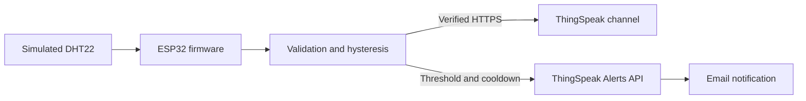

# IoT Weather Station with Email Alerts

ESP32 C++ firmware that reads a DHT22, uploads temperature and humidity to ThingSpeak over verified HTTPS, and requests an email when a threshold is exceeded. The Wokwi edition was compiled and exercised end to end with simulated sensor data on 15 October 2026.

**[Open the verified Wokwi simulation](https://wokwi.com/projects/477924293384510465)**

## Features

- Temperature and humidity sampling at intervals of at least 20 seconds.
- Range checks reject invalid sensor samples.
- Independent temperature and humidity alarms with hysteresis to avoid threshold chatter.
- ThingSpeak channel uploads and email requests over TLS with a public CA certificate and NTP time synchronization.
- A 31-minute email-attempt cooldown; runtime keys are held in RAM in the simulation.
- Startup self-tests in the Wokwi sketch, plus a host-side C++ logic test for the physical-board helper.

## Architecture



## Run in Wokwi

1. Open the simulation link above. To use your own ThingSpeak account, fork the simulation and change the channel number in `sketch.ino` to your channel ID.
2. Create temperature and humidity fields in your channel, and obtain its write API key and your ThingSpeak Alerts API key.
3. Start the simulation and wait for `SELF-TEST PASS` and the configuration prompt.
4. Enter `CONFIG <channel_write_key> <alerts_key>` in the serial input. Do not save the actual keys in source code. Configuration must be repeated after restart.
5. Click the DHT22 and set the scenarios below. Allow at least 20 simulation seconds plus network time between readings.
6. Check accepted upload entry IDs and the feed in your own ThingSpeak channel. A 202 alert response means queued; check your inbox separately.
7. Stop the simulation when finished. Respect ThingSpeak's account-wide email quota.

The Wokwi public gateway is monitored. Use dedicated project keys and never enter personal Wi-Fi credentials. This repository does not grant access to the original private ThingSpeak dashboard.

## Wiring

| DHT22 connection | Wokwi ESP32 |
| --- | --- |
| VCC | 3V3 |
| DATA | GPIO15 |
| GND | GND |
| NC | Unconnected |

Connect a 10 kohm pull-up between DATA and 3V3. `wokwi/diagram.json` contains the virtual circuit. The optional physical-board edition uses GPIO4 and the Adafruit library instead of GPIO15 and DHTesp.

## Alarm behavior and recorded checks

| Scenario | Temperature | Humidity | Recorded outcome |
| --- | --- | --- | --- |
| Normal | 28 C | 60% | Upload accepted; alarm clear |
| Threshold | 36 C | 83% | Upload accepted; alarm active; email request accepted |
| Recovery | 32 C | 74% | Upload accepted; alarm cleared |

Alarm triggers at temperature >35 C or humidity >80%. Temperature clears at <=33 C and humidity clears at <=75%.

The original verification checked feed readback, alert dispatch history, and receipt of the matching email. It recorded 15 Wokwi uploads after four earlier desktop commissioning entries. These are simulated DHT22 readings, not physical weather measurements. This publication preserves the source; it does not claim a new live cloud run. See [validation](docs/validation.md).

## Optional physical-board build

Install PlatformIO, copy `firmware/WeatherStation/config.example.h` to `config.h` in the same directory, and set your own Wi-Fi details, channel ID and API keys. `config.h` is ignored by Git.

```bash
cd firmware
pio run
pio run --target upload
pio device monitor --baud 115200
```

The supplied PlatformIO environment targets `esp32dev`. The earlier local Windows build was blocked by a compiler-launch error; this physical-board edition has not been verified on hardware. The Wokwi edition is the tested implementation.

## Run host logic checks

With a C++11-compatible compiler, from the repository root:

```bash
g++ -std=c++11 tools/test_logic.cpp -o weather_logic_test
./weather_logic_test
```

On Windows, use `weather_logic_test.exe`. The test covers invalid readings, boundary conditions, hysteresis and `millis()` rollover. Wokwi has a separate inline implementation and its own startup checks; this host test does not test cloud delivery.

## Repository layout

```text
wokwi/                       Tested standalone sketch and virtual circuit
firmware/WeatherStation/     Optional physical ESP32 firmware and config template
firmware/platformio.ini      Physical-board build environment
tools/test_logic.cpp        Host-side logic assertions
docs/validation.md          Recorded verification scope and limitations
THIRD_PARTY.md              Dependency and public certificate attribution
```

## Limitations

Physical calibration, outdoor operation, router interruption, full cooldown expiry and NVS persistence between separate Wokwi sessions have not been verified. Offline samples are dropped rather than buffered. No performance or reliability guarantees are claimed.

Built and documented by **Thulasiram Sudheeswar Reddy**. Dependency licenses remain with their respective owners; see [THIRD_PARTY.md](THIRD_PARTY.md).
